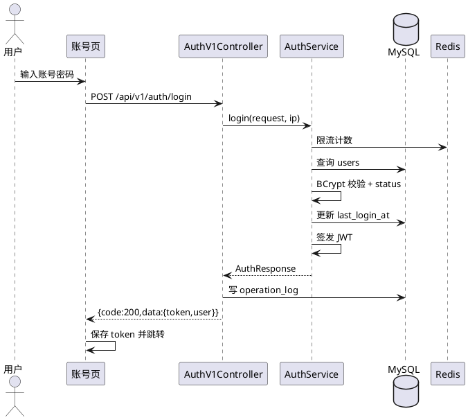

# 数据流转 · 注册 / 登录 / 快捷登录

## 1. 场景说明

匿名访客在账号页完成注册或登录；本地验证时可使用体验账号免密登录。登录成功是建档、训练、饮食的前置条件。

## 2. 用户操作

- 注册：账号页 →「注册」Tab → 填写账号、密码、确认密码、昵称 → 勾选隐私政策与服务条款 →「注册并登录」。
- 登录：账号页 →「登录」Tab → 账号 + 密码 →「登录」。
- 快捷登录：账号页「快捷登录（体验）」→「体验用户」或「体验管理员」（仅 `DEMO_LOGIN_ENABLED=true` 时显示）。
- 支付宝：欢迎页或账号页 →「支付宝登录 / 注册」。

## 3. 接口调用

| 顺序 | 方法 | 路径 | 说明 |
|---|---|---|---|
| 1 | GET | `/api/v1/auth/demo` | 查询快捷登录开关与账号（未登录） |
| 2 | POST | `/api/v1/auth/register` | 自助注册，body 含 `acceptedTerms` |
| 3 | POST | `/api/v1/auth/login` | 账号密码登录 |
| 4 | POST | `/api/v1/auth/demo-login` | 体验账号免密登录，body `{account}` |
| 5 | GET | `/api/auth/alipay/start` | 支付宝授权跳转 |
| 6 | GET | `/api/auth/alipay/callback` | 回调换用户并签发 JWT |

## 4. 数据变更

### 4.1 注册

1. 校验账号 3-32 位、密码 8-64 位、`acceptedTerms=true`。
2. 检查 `users.username` 唯一；停用账号仍占用用户名，返回 409001。
3. 插入 `users`：`username`、`password_hash`（BCrypt 10）、`nickname`、`role='USER'`、`status=1`、`plan='free'`、`created_at`。
4. 更新 `last_login_at`，签发 JWT；写 `operation_log`：`REGISTER_SUCCESS`。

### 4.2 登录

1. Redis 限流键 `auth:login:{ip}:{username}`，5 次/分钟；成功即重置。
2. 读取 `users`，校验 BCrypt 密码与 `status=1`。
3. 更新 `last_login_at`，签发 JWT（默认 120 分钟）。
4. 写 `operation_log`：成功 `LOGIN_SUCCESS`，失败 `LOGIN_FAILED` + 原因。

### 4.3 快捷登录

1. 服务端校验 `fitplan.auth.demo-login=true`，否则 403。
2. 账号映射：`user → demo_user`、`admin → demo_admin`；账号由启动时创建，密码为随机值。
3. 校验 `status=1`，更新 `last_login_at`，签发 JWT。
4. 写 `operation_log`：`DEMO_LOGIN`，详情「快捷登录：体验管理员」。

### 4.4 支付宝

1. `oauth_states` 写入一次性 state。
2. 回调校验 state → 换 `access_token` → 取 `user_id` → `users` 按 `alipay_uid` upsert。
3. 按用户 ID 签发 JWT，302 到 `{FITPLAN_FRONT}/#token=<JWT>`。

## 5. 页面反馈

- 成功：写入 `fitplan.token`；未建档跳 `#/setup`，已建档停留账号页或回运动页。
- 失败：表单上方红色提示条，按钮恢复可点；注册未勾选隐私时按钮保持置灰。
- 停用账号：提示「账号已被禁用」，不签发 JWT。

## 6. 异常与边界

- 账号已占用：409001「账号已被占用」。
- 账号或密码错误：401002「账号或密码错误」。
- 停用：401003「账号已被禁用」。
- 频率过高：429001「登录太频繁，请一分钟后再试」。
- Redis 不可用：限流退回单机内存，登录不受影响。

## 7. 时序图

