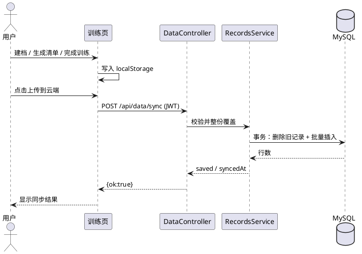

# 数据流转 · 建档与训练

## 1. 场景说明

已登录用户完成档案，生成周框架与今日清单，训练结束后写入逐组记录；随后可整份上传云端。所有业务数据在未上传前只存在本机。

## 2. 用户操作

1. 首次登录后进入 `#/setup`，分步填写档案，点击「完成」。
2. 运动页点击「生成周框架」，进入 `#/plan` 查看。
3. 当天点击「今天练哪里」，选择部位与时长，点击「生成今日清单」。
4. 进入 `#/session`，逐组填写重量/次数/RPE，点击「完成」。
5. 需要备份时进入「设置 → 数据与备份」，点击「上传到云端」。

## 3. 接口调用

| 顺序 | 方法 | 路径 | 说明 |
|---|---|---|---|
| 1 | — | 无 | 建档、框架、清单、逐组记录都在本机完成 |
| 2 | POST | `/api/v1/auth/login` | 前置：登录拿 JWT |
| 3 | POST | `/api/data/sync` | 整份上传业务数据（需登录） |
| 4 | GET | `/api/data` | 新设备拉回（需登录） |

> 大模型解析目标时由浏览器直连用户填写的 OpenAI 兼容接口，后端不参与。

## 4. 数据变更

### 4.1 本机

1. 档案、周框架、今日清单、逐组记录写入 `localStorage['fitplan.v1']`。
2. 页面路由由 `App.jsx` 的登录门槛与建档门槛控制。

### 4.2 云端上传

1. 请求体 ≤ 8 MB；每类列表 ≤ 20000 行。
2. 事务内先删除该用户 7 张记录表的旧数据，再插入本次快照。
3. 更新 `profiles.uploaded_at`；返回各表写入行数与 `syncedAt`。
4. 记录日期必须 `YYYY-MM-DD`；ID 仅允许字母、数字、`_ : . -`。

## 5. 页面反馈

- 建档完成：进入 `#/plan`，生成中显示加载态。
- 生成清单：跳 `#/session`，顶部显示动作与目标组次。
- 完成训练：Toast 提示已写入记录，返回 `#/log` 可查看。
- 上传成功：显示各表行数与同步时间；失败显示服务端中文原因。

## 6. 异常与边界

- 未登录：业务路由统一回 `#/welcome`，不产生云端请求。
- 未建档：允许「先随便练练」，但饮食目标只按缺省值计算。
- 上传过旧快照：整份覆盖，云端旧记录被删除，不做合并。
- 超限：请求体超 8 MB 返回 413；列表超 20000 行返回 400。
- 云端无记录：`GET /api/data` 返回 404。

## 7. 时序图

