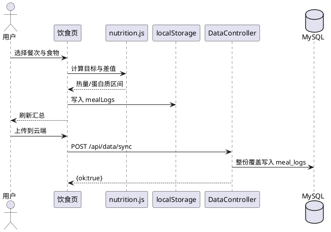

# 数据流转 · 饮食记录

## 1. 场景说明

已登录用户按餐次记录食物，页面根据档案计算 TDEE、热量区间与蛋白质目标，并展示当日差值与体重趋势。

## 2. 用户操作

1. 底部 Tab 进入「吃」`#/diet`。
2. 选择餐次（早餐/午餐/晚餐/加餐）。
3. 在食物库检索并选择食物，填写份量，点击「添加」。
4. 查看当日热量、蛋白质、碳水、脂肪汇总与目标差值。
5. 需要备份时在「数据与备份」上传云端。

## 3. 接口调用

| 顺序 | 方法 | 路径 | 说明 |
|---|---|---|---|
| 1 | — | 无 | 食物检索、营养计算、记录均在本机 |
| 2 | POST | `/api/data/sync` | 上传时包含 `mealLogs` |
| 3 | GET | `/api/data` | 拉回时恢复 `mealLogs` |

## 4. 数据变更

1. 食物库 `frontend/src/data/foods.json` 只读，不落库。
2. 记录写入 `localStorage['fitplan.v1'].mealLogs`：`slot`、`name`、`kcal`、`protein_g`、`carbs_g`、`fat_g`、`sugar_g`、`sodium_mg`、`loggedTs`。
3. 目标值由 `lib/nutrition.js` 依据 `profile` 计算，不写库。
4. 云端同步时 `slot` 只允许 `breakfast / lunch / dinner / snack`。

## 5. 页面反馈

- 添加成功：对应餐次列表立即插入，汇总与差值同步刷新。
- 档案缺失：展示缺省目标并提示先建档。
- 删除记录：二次确认后移除，汇总重算。
- 同步失败：提示服务端原因，本机数据不回滚。

## 6. 异常与边界

- 份量非法（0 或负数）：按钮置灰或提示修正。
- 未登录：路由回 `#/welcome`。
- 云端记录超限：上传返回 400，提示减少记录或分批清理。
- 同一天同一食物多次记录：允许，按多条累加。

## 7. 时序图

