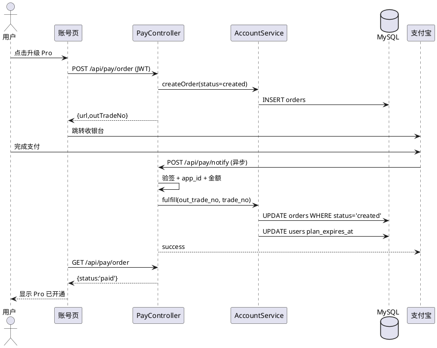

# 数据流转 · VIP 购买与支付

## 1. 场景说明

已登录用户在账号页发起 Pro 订阅，跳转支付宝收银台；支付结果以支付宝异步通知为准，前端只做状态回显。

## 2. 用户操作

1. 账号页「订阅」卡片点击「升级 Pro」或「续 N 天」。
2. 浏览器跳转支付宝收银台完成支付。
3. 从支付宝返回账号页，页面查询订单状态。

## 3. 接口调用

| 顺序 | 方法 | 路径 | 说明 |
|---|---|---|---|
| 1 | POST | `/api/pay/order` | 创建订单并返回收银台 URL |
| 2 | GET | `/api/pay/order?out_trade_no=xxx` | 从收银台返回后查询状态 |
| 3 | POST | `/api/pay/notify` | 支付宝服务端异步通知，表单提交 |

## 4. 数据变更

### 4.1 下单

1. 校验登录；`payMissing()` 非空时返回 400「收款还没在这台服务上开通」。
2. 金额按下单时价格换算成分，订单号 = 本机时间 + 随机后缀。
3. 插入 `orders`：`out_trade_no`、`user_id`、`plan='pro'`、`days`、`amount_cent`、`status='created'`。
4. 前端保存 `fitplan.order = out_trade_no` 并跳转支付宝。

### 4.2 异步通知

1. 验签（RSA2）→ 校验 `app_id` → 校验金额（分）→ 校验交易状态。
2. `TRADE_SUCCESS / TRADE_FINISHED`：条件更新 `orders SET status='paid', paid_at=NOW(), trade_no=? WHERE out_trade_no=? AND status='created'`。
3. 更新成功才顺延 `users.plan_expires_at`：从「原到期时间」与「现在」较晚者开始加 `days`，并置 `plan='pro'`。
4. 重复通知：条件更新影响行数为 0，直接返回 `success`，不重复加天数。
5. `TRADE_CLOSED`：`orders.status='closed'`；金额不一致：返回 `failure` 并留日志。

### 4.3 状态查询

- 订单不属于当前用户返回 403；无订单返回 `status='none'`。

## 5. 页面反馈

- 下单成功：整页跳转支付宝，按钮进入 loading。
- 返回后：轮询/查询到 `paid` 时提示「这单已经到账，Pro 已开通」，刷新订阅卡片。
- 未到账：保留「刷新状态」入口，不本地伪造到期时间。
- 收款未配置：按钮显示「收款还没开通」并禁用。

## 6. 异常与边界

- 未登录：401，前端回欢迎页。
- 支付宝未配置：400，不创建订单。
- 金额不一致：不发货，返回 `failure` 供支付宝重试并留日志。
- 并发重复通知：条件更新保证只发货一次。
- 支付成功后管理员退款：见 `05_admin_management.md`。

## 7. 时序图

