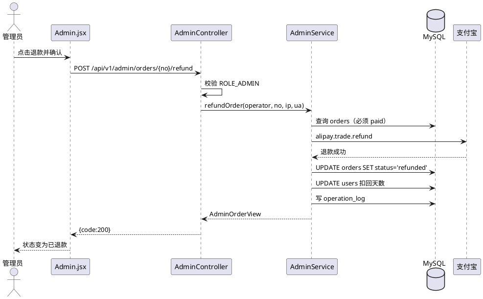

# 数据流转 · 管理后台操作

## 1. 场景说明

管理员登录后进入 `#/admin`，对账号、订单和审计日志进行操作；所有管理操作写入 `operation_log`。

## 2. 用户操作

1. 管理员登录 → 设置页出现「管理后台」→ 进入 `#/admin`。
2. 账号管理：搜索账号 →「停用/启用」→ 确认；或「开通 VIP」输入天数。
3. 订单管理：按状态筛选 → 待支付点「关闭订单」；已支付点「退款」→ 确认全额退款。
4. 操作日志：搜索操作人或动作，分页查看。

## 3. 接口调用

| 顺序 | 方法 | 路径 | 说明 |
|---|---|---|---|
| 1 | GET | `/api/v1/admin/users` | 账号分页，`keyword/pageNum/pageSize` |
| 2 | PATCH | `/api/v1/admin/users/{id}/status` | 停用/启用，body `{status:0/1}` |
| 3 | POST | `/api/v1/admin/users/{id}/vip` | 开通 VIP，body `{days:1..3650}` |
| 4 | GET | `/api/v1/admin/orders` | 订单分页，`keyword/status/pageNum/pageSize` |
| 5 | POST | `/api/v1/admin/orders/{outTradeNo}/close` | 关闭待支付订单 |
| 6 | POST | `/api/v1/admin/orders/{outTradeNo}/refund` | 已支付订单全额退款 |
| 7 | GET | `/api/v1/admin/operation-logs` | 全量日志分页，`keyword/action` |

## 4. 数据变更

### 4.1 停用 / 启用

1. 校验目标账号存在；不能停用当前登录管理员。
2. 停用管理员时，校验启用中的管理员数量 > 1。
3. 更新 `users.status`；停用后 JWT 过滤器下次请求即拒绝。
4. 写 `operation_log`：`ADMIN_DISABLE_USER` / `ADMIN_ENABLE_USER`。

### 4.2 开通 VIP

1. 校验目标账号与天数范围。
2. 更新 `users`：`plan='pro'`，`plan_expires_at = DATE_ADD(GREATEST(COALESCE(plan_expires_at,NOW()),NOW()), INTERVAL ? DAY)`。
3. 写 `operation_log`：`ADMIN_GRANT_VIP`，详情「开通 N 天」。

### 4.3 关闭订单

1. 仅 `status='created'` 可关闭，否则 400。
2. 支付宝已配置时先调用 `alipay.trade.close`；失败返回 502，不改本地状态。
3. 条件更新 `orders.status='closed'`；写 `operation_log`：`ADMIN_CLOSE_ORDER`。

### 4.4 退款

1. 仅 `status='paid'` 可退款；支付宝未配置时返回 400 并列出缺失项。
2. 调用 `alipay.trade.refund` 全额退款（`out_request_no` 固定为订单号，重复提交幂等）。
3. 条件更新 `orders.status='refunded', refunded_at=NOW()`；影响 0 行返回 409。
4. 扣回该单 `days`：`plan_expires_at = plan_expires_at - days`，扣完小于当前时间则 `plan='free'`。
5. 写 `operation_log`：`ADMIN_REFUND_ORDER`，含金额与订单号。

### 4.5 日志

- 只读分页；`operation_log` 不设外键，账号注销后仍保留。

## 5. 页面反馈

- 停用/启用：刷新当前页，显示「xxx 已停用/启用」。
- 开通 VIP：刷新账号卡片，显示新的到期时间。
- 关闭订单：订单状态标签变为「已关闭」，操作按钮消失。
- 退款：状态变为「已退款」并显示退款时间；失败时显示服务端原因（如未配置支付宝）。
- 日志：按动作与关键词过滤，分页展示。

## 6. 异常与边界

- 非 ADMIN：403，前端不显示入口。
- 停用自己 / 最后一个管理员：400。
- 订单状态已变化：409，提示刷新。
- 支付宝关单/退款失败：502，本地状态不变。
- 退款成功但本地更新失败：返回 409，日志标记 FAILURE，需人工核对。
- 体验账号被停用：快捷登录返回「账号不存在或已停用」，重启不会自动恢复。

## 7. 时序图

