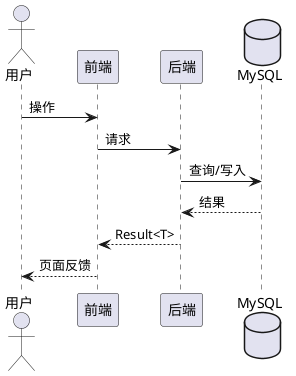

# 数据流转 · 模板

## 1. 场景说明

一句话说明谁在什么页面做什么，前置条件是什么。

## 2. 用户操作

按顺序列出点击、输入、确认等动作，包含按钮文案与二次确认。

## 3. 接口调用

| 顺序 | 方法 | 路径 | 说明 |
|---|---|---|---|
| 1 | POST | `/api/v1/xxx` | 请求目的 |

## 4. 数据变更

1. 事务边界（是否开启、`rollbackFor`）。
2. 读取/校验了哪些表与字段。
3. 写入/更新了哪些表，条件是什么，是否幂等。
4. 缓存/审计/外部调用的副作用。

## 5. 页面反馈

成功后的跳转、Toast/提示文案、按钮状态；失败时的提示与置灰规则。

## 6. 异常与边界

- 参数非法：
- 未登录/越权：
- 并发/重复提交：
- 依赖不可用（Redis/MySQL/支付宝）：

## 7. 时序图

